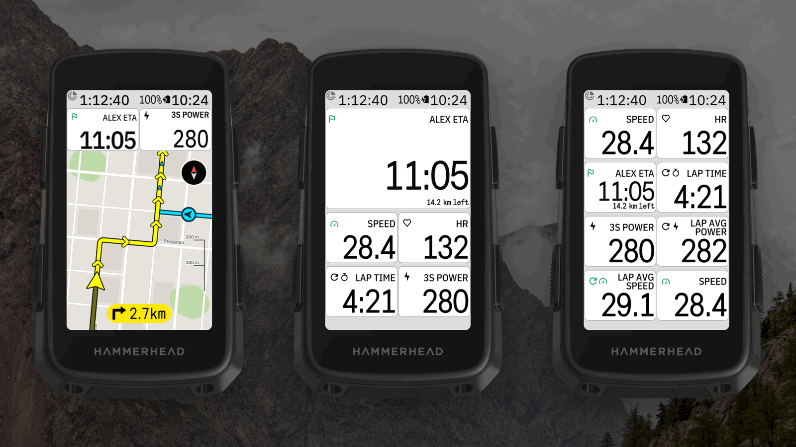
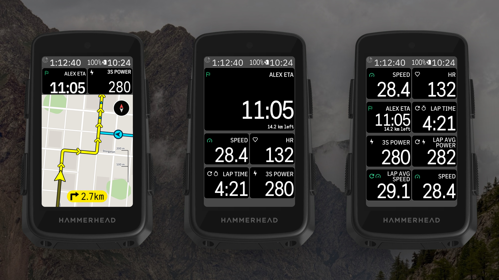

<!-- docs.sh: generated from docs/app.yml. Edit that file and run setup/docs.sh, not this block. -->

# PartnerETA for Karoo 3

Listed on the Karoo as **DDB PartnerETA**, next to the other DDB apps.

A Hammerhead Karoo 3 extension for following the people you ride with (up to four). Paste their
Karoo live tracking link once, and while they ride you see them and their route on your map, plus
a data field each:
when they'll reach the end of their route, or how far ahead or behind they are on the same road.

- **On your map:** each person as a circle or arrow in their own colour, their route (or hide it
  and keep just the marker and finish flag), and arrows (or dots) where they'll ride your route too.
- **ETA field:** the clock time they'll reach the end of their route, with the distance left.
  On the same route it shows the gap instead: `Alex ahead` / `Alex behind`.
- **States:** paused, arrived, last update a few minutes ago, or no connection, drawn the
  Karoo's way (its own value font; a grey flag when there's no news).
- **Setup page** (open **DDB PartnerETA** from the Karoo's app list): the people you follow,
  **+ Add person**, and per person their name, live link (checked right away), map colour,
  marker, route and ride history.
- **Update notices** on the Karoo when a new release is out.

More in the [rider guide](docs/guide/README.md). Problems or ideas:
[Issues](https://github.com/Dubadai/karoo-partnereta/issues).

Data comes from the live link's feed (`/v1/shares/tracking/<code>`, unofficial, no login), fetched
every 30 s through the Karoo's own connection (Wi-Fi or the phone).

Building it yourself or making a release: see [docs/DEVELOPING.md](docs/DEVELOPING.md).

## Install on your Karoo

1. On your phone, open the [latest release](https://github.com/Dubadai/karoo-partnereta/releases/latest)
   and share `partnereta.apk` to the **Hammerhead Companion** app (or with a computer: `adb install partnereta.apk`).
2. Open **DDB PartnerETA** from the app list, tap **+ Add person** and paste their live-tracking link.
3. In a ride profile, add **DDB PartnerETA → PartnerETA 1** (one per person) to a page.

<!-- /docs.sh -->

## Licence

MIT, see `LICENSE`. The included Karoo SDK in `karoo-ext/` is Apache 2.0, see `karoo-ext/LICENSE`.
