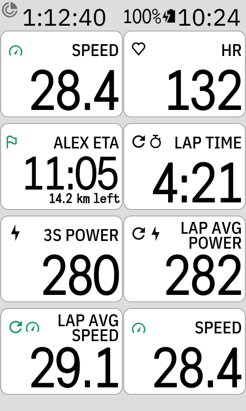
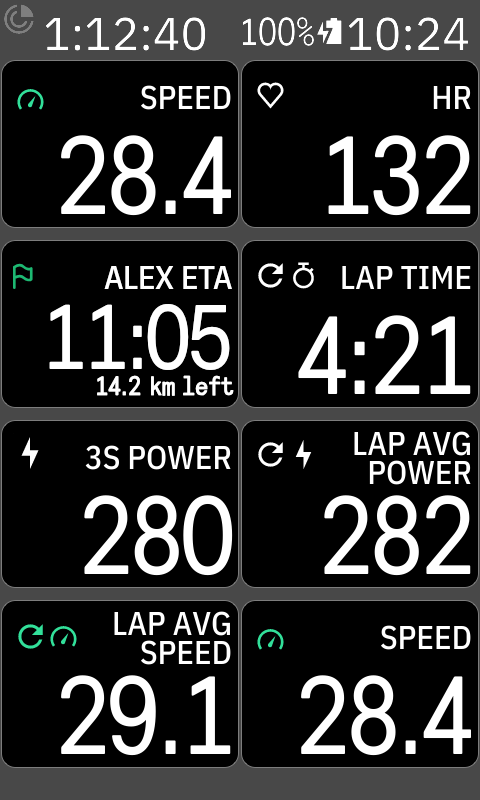
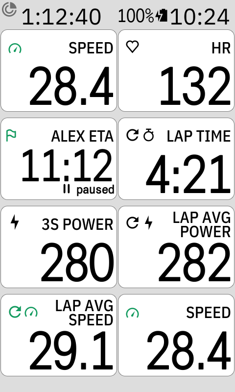
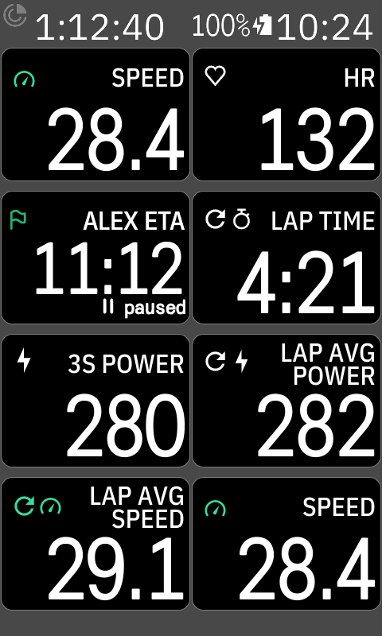
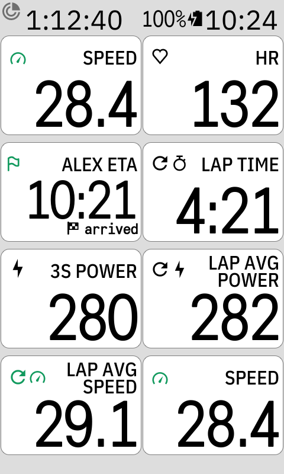
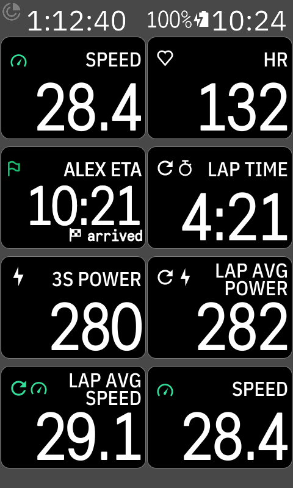
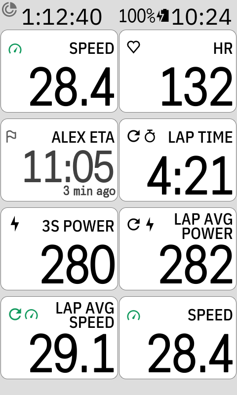
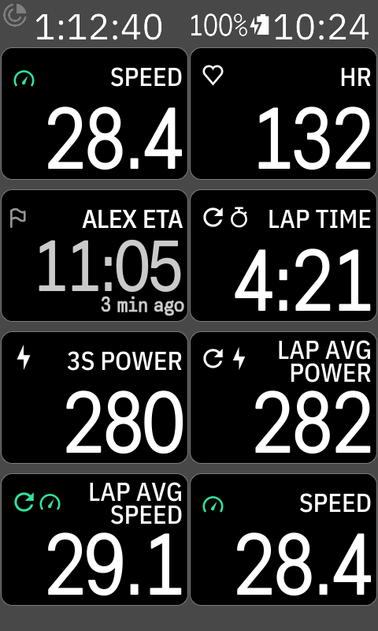
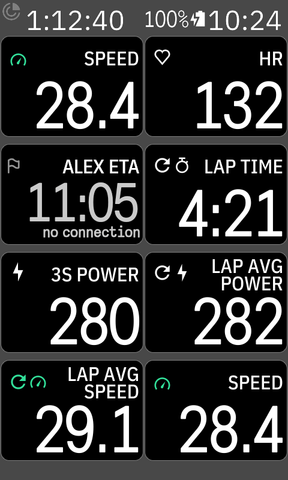

# PartnerETA: rider guide

PartnerETA shows the people you ride with on your Karoo while they ride: where they are, their
route, and when they'll be done. You can follow up to four people; each needs their Karoo live
tracking link.

## Set it up

1. Your partner starts **live tracking** on their Karoo and sends you the link
   (`dashboard.hammerhead.io/live/…`).
2. On your Karoo, open **DDB PartnerETA** from the app list and tap **+ Add person**. Type
   their name and paste the link. The app checks it right away: *Riding now*,
   *Link works · not riding now*, or *Link not found*.
3. Add their field: Profiles → a ride page → tap a field → **DDB PartnerETA → PartnerETA 1**
   (2, 3, 4 for the next people; the list in PartnerETA says who is which). Any size works.

Tap a person in the list to change their settings or remove them. Each person has their own map
colour (standard is the clearest), marker (circle or arrow), their route on your map (show or
hide: hidden leaves their marker and finish flag), arrows or dots where they'll ride your route
too, distance left, and ride history (off keeps the map clear).

## The field

 

**Alex ETA** is the clock time they'll reach the end of their route, with how far they still have
to ride under it. On the same route as you, it shows **Alex ahead** or **Alex behind** with the gap.

| | |
| --- | --- |
|   | **Paused**: they've stopped. The ETA moves later while they stand. |
|   | **Arrived**: they're at the end of their route. |
|   | **3 min ago**: no new position for a while; the time is greyed out. |
|   | **No connection**: your Karoo can't reach the internet (Wi-Fi or the phone). The flag turns grey. |

Without a time to show, the field says why in words, like the Karoo's own "No Sensor":
*Not riding*, *Connecting*, *No connection* or *Not set up*.

## Good to know

- Positions come from the live link every 30 seconds, over your Karoo's own connection.
